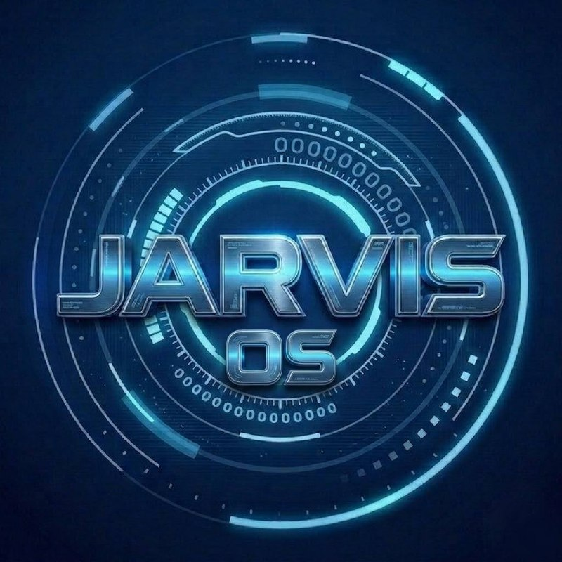
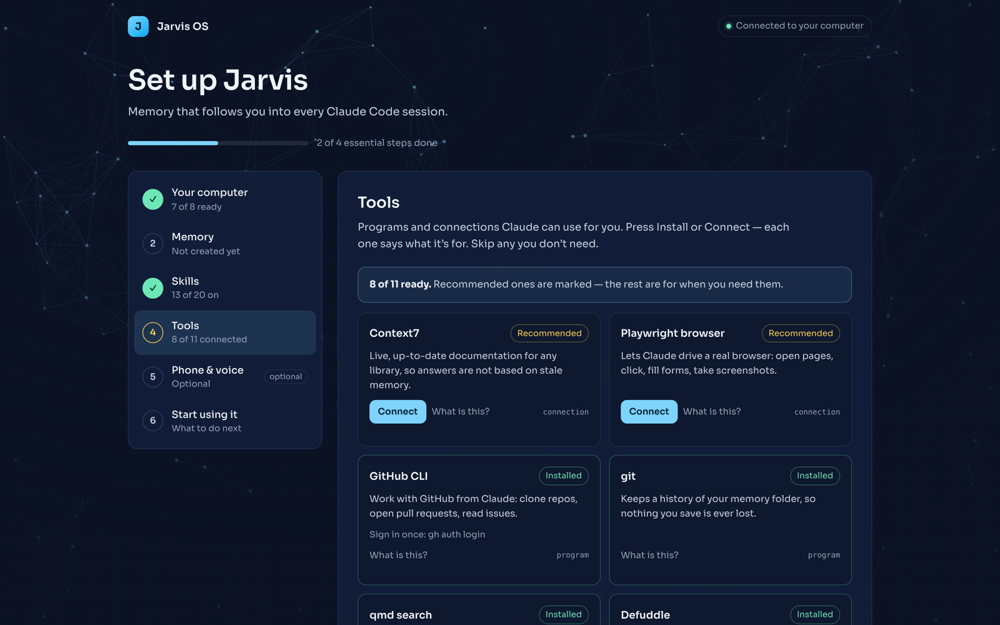

<p align="center">
  
</p>

<h1 align="center">Jarvis OS</h1>

<p align="center">
  <b>Claude Code forgets you between conversations. This fixes that.</b><br>
  A memory that follows you into any project, plus skills that keep it up to date on their own.
</p>

<p align="center">
  <a href="LICENSE"></a>
  
  
  
  <a href="https://github.com/ManceRayder42/jarvis-os/stargazers"></a>
</p>

## Quick start

No account, no API key, nothing to pay for.

**1. Install it.** In Claude Code, run:

```bash
claude plugin marketplace add ManceRayder42/jarvis-os
claude plugin install jarvis-os
```

One step on Claude Code 2.1.275 or later: `/plugin install jarvis-os --marketplace ManceRayder42/jarvis-os`

**2. Restart Claude Code and say "set me up".** Claude creates your memory
folder, turns on the default skills and connects the free tools. It asks once
before installing any software, and leaves you only what needs a person: a key
or a sign-in.

**Rather click through it?** Type `/jarvis-setup` for a local checklist page
that does the same thing.

<p align="center">
  
</p>

## Works with Claude Code, Codex and Cursor

Same memory folder, same skills, same tools. Claude Code is the full experience;
Codex and Cursor get the same three things through their own config files, with
the gaps listed in [details](docs/details.md#codex-and-cursor).

| | Install |
|---|---|
| **Claude Code** | the two lines above |
| **Codex CLI** | `git clone https://github.com/ManceRayder42/jarvis-os ~/.jarvis-os && node ~/.jarvis-os/setup/agent.mjs setup --host codex && node ~/.jarvis-os/setup/agent.mjs install-host codex`, then run `/hooks` once inside Codex and trust the hook |
| **Cursor** | the same with `cursor`, then `node ~/.jarvis-os/setup/agent.mjs install-host cursor --print-user-rule` and paste the output into Cursor Settings, Rules, User Rules |

It backs up any file it edits and never overwrites yours. Undo:
`node ~/.jarvis-os/setup/agent.mjs uninstall-host codex` (or `cursor`).

## What you actually get

Claude Code normally starts every conversation from nothing — it doesn't
remember what you told it yesterday, or in a different project folder. This
plugin gives it a **memory** (technically a "hub": just one folder on your
computer, created for you during setup, that Claude reads at the start of
every conversation no matter which project you're in).

On top of that memory, it adds a set of **skills** — extra abilities Claude
picks up automatically when they're relevant. A few examples: closing out a
work session properly so nothing is forgotten, researching a topic with
citations, or turning a long explanation into a simple visual page instead of
a wall of text. [The full list](docs/details.md#the-full-skill-list) is in the details.

## The one thing you have to remember

**Say "done" (or type `/done`) when you finish working.**

That's the only habit this asks of you. Memory loading and skills happen
automatically. Saying "done" tells Claude to
write down what happened and fold it into your memory's history, so your
*next* conversation actually knows about it.

Skip it, and nothing breaks — but nothing new gets remembered either, and you
won't see an error telling you so. That invisible failure is exactly why it's
worth turning into a habit. **If you take one thing from this page, take
this one.**

## What this is not

- **Not a copy of one person's personal setup.** Nothing here is tied to
  someone else's projects or preferences — you fill in your own memory as you
  use it.
- **Not a replacement for Claude Code's own project memory.** That's a
  different, narrower feature; the two work fine side by side.
- **Not going to tell you how to work.** A couple of routing/workflow
  defaults ship with a stated reason, never as "the one correct way."

## More

[How it works, the full skill list, optional skills, the phone assistant and licenses](docs/details.md).

### Contributing

Issues and PRs welcome — see [CONTRIBUTING.md](CONTRIBUTING.md). Security
matters are in [SECURITY.md](SECURITY.md).

### License

MIT — see [LICENSE](LICENSE).
